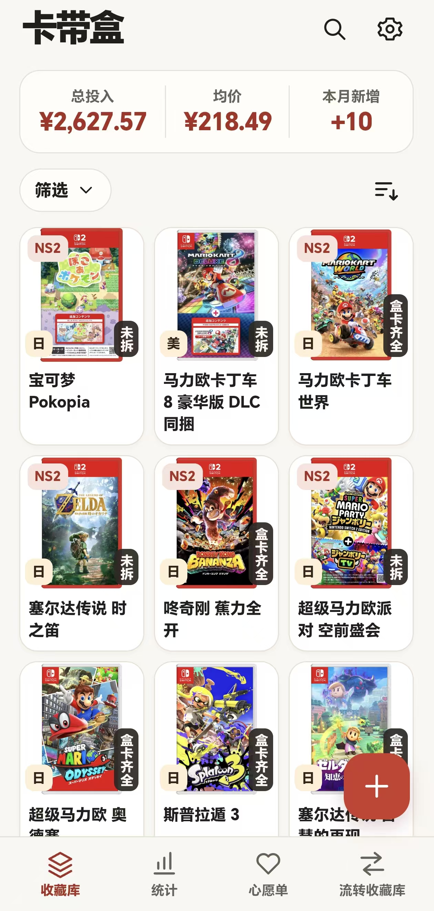
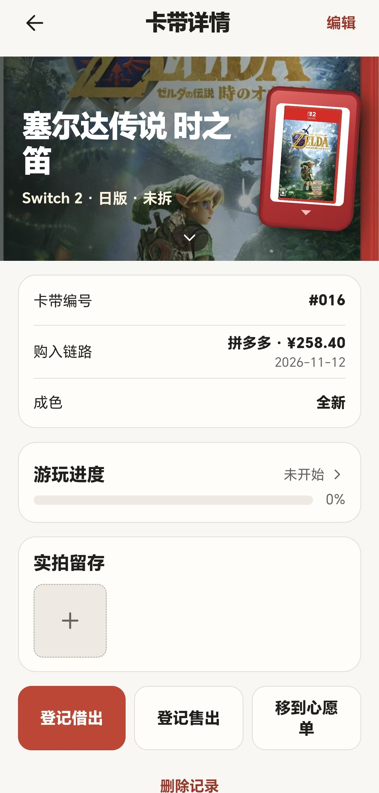
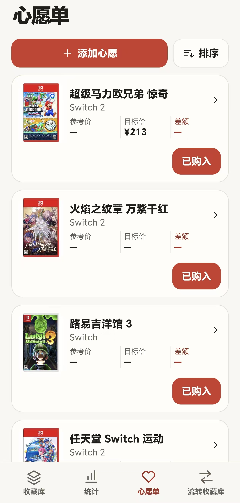
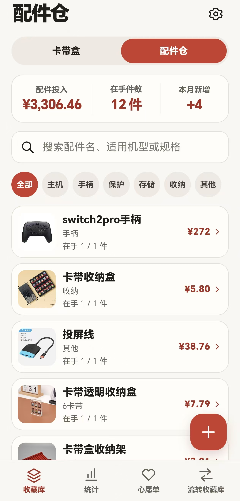

# 卡带盒 Kadaihe

卡带盒是一款面向 Nintendo Switch 和 Switch 2 实体卡带收藏者的安卓工具。用它记录每张卡带的版本、购入价格和收纳位置，管理借还和心愿单，并核算售出盈亏。

## 界面预览

| 收藏库 | 卡带详情 | 心愿单 |
| :---: | :---: | :---: |
|  |  |  |

## 主要功能

- **收藏库：**  
  支持扫码、游戏中文名联想、手动选图、实拍留存、排序和筛选。

- **心愿单和流转记录：**  
  支持目标价、借入、借出、归还提醒、运费和售出记录。

- **统计：**  
  汇总购买支出、借还支出、售出回血和单张均价。

- **封面交互：**  
  支持长按封面编辑或删除，详情页下拉可看完整盒面。

- **导入和备份：**  
  支持 CSV 导入收藏卡带、CSV 导出，以及包含照片的 ZIP 备份和恢复。

记录保存在设备上。公开发布版本内置部分中文游戏名和别名，封面可从相册选择或拍摄。

## 新增功能

- **新增配件仓：**
        现在，可以设置switch配件的购买记录了，无论是保护壳、收纳盒、手柄等都可以填写。
  
   

## 安装

[直接下载安卓 APK（卡带盒 2.6.6）](https://github.com/mindworke/kadaihe/releases/download/v2.5/kadaihe-2.6.6.apk)

需要 Android 8.0（API 26）或以上。更新签名一致的安装包时，可以直接覆盖安装。ZIP 备份可在「设置与备份」中导出。

## 日版封面下载与访问令牌

2.6.6 已接入公开封面库。联网后即可查找和下载日版封面，无需登录或填写令牌。[打开公开封面库](https://kadaihe-cover-downloads.primeaster16.chatgpt.site/)

1. 新增或编辑卡带时，输入游戏的中文名。有明确匹配时，App 会自动下载封面。看到好几个结果，就选你手上那一版，比如 Switch 2 普通版或游戏钥匙卡。
2. 没找到合适的图，可以点「查找日版封面」再试，也可以拍照或从相册换一张。

## 源码结构

- `app/java` 存放安卓入口、扫码、备份、通知与可选封面库接口。
- `app/assets` 存放界面、收藏管理、中文名称索引及 CSV 处理。
- `app/res` 存放图标和安卓主题资源。

扫码使用 [ZXing Core](https://github.com/zxing/zxing)，许可证随源码放在 `app/assets/licenses/zxing.txt`。Nintendo 和 Nintendo Switch 是其权利人的商标。卡带盒是独立收藏工具。
